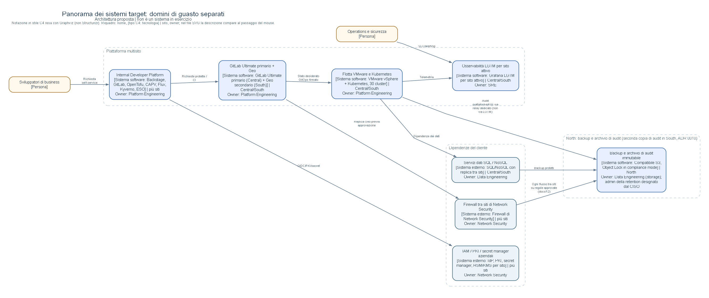
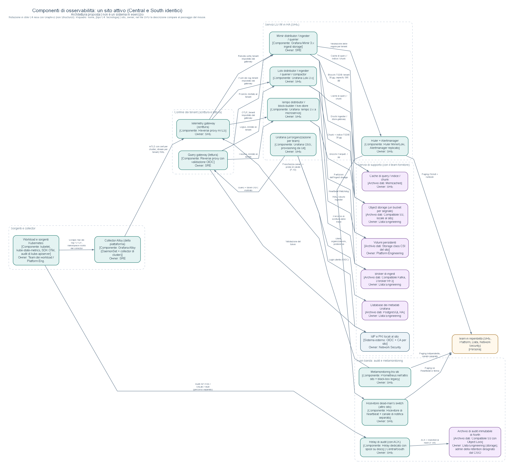

# Piattaforma interna per sviluppatori su tre siti: proposta di architettura

Proposta di architettura target, candidata alla revisione, datata 2026-11-05. Copre architettura, decisioni, rollout, rischi, NFR e capacità, costi, governance e criteri di accettazione, ed è rivolta a CIO, CISO e CFO e ai team Platform Engineering, SRE, Data Engineering e Network Security.

Si tratta di **una proposta di progetto, non di un sistema in esercizio**. Ogni numero è una stima modellata o un'assunzione dichiarata. Le affermazioni sui prodotti rimandano a documentazione datata, raccolta in [docs/14](docs/14-references.md): fonti ufficiali dove disponibili, con le poche fonti secondarie segnalate. Quelle che dipendono da una versione specifica sono indicate come da verificare sulla versione adottata.

## La decisione in un paragrafo

Proponiamo di costruire prima l'osservabilità, sito per sito, e di mantenere il monitor black-box legacy finché ogni suo check non ha una parità firmata. Central e South hanno ciascuno il proprio management Kubernetes, il proprio enforcement delle policy e il proprio data plane Grafana LGTM, con isolamento dei tenant sia in scrittura sia in lettura. South esegue in proprio, già prima di qualsiasi disastro, identità, PKI, secret, DNS, vCenter e registry, e ospita controparti DR calde 1:1 dei cluster di produzione, con una riserva di capacità e dati replicati in continuo. Per questo la perdita di Central è recuperabile entro **RPO 1 h / RTO 4 h**, ma come progetto condizionato: il percorso modellato dura 175 minuti e solo un drill può dimostrarlo. North conserva i backup immutabili e una delle due copie dell'archivio di audit. La toolchain è composta da GitLab Ultimate (security policy non aggirabili, Geo), OpenTofu, Cluster API vSphere (VKS se il cliente ha la licenza VCF), Flux e Backstage. L'ordine di grandezza è di circa 4,2 M€ in 3 anni, con un intervallo di 2,6–6,9 M€: una cifra illustrativa, non una quotazione.

## Percorso di lettura

| # | Documento | Contenuto |
|---|---|---|
| 1 | [One-pager esecutivo](docs/00-executive-one-pager.md) · [PDF, 1 pagina](deliverables/Executive_Decision_Brief.pdf) | Cosa si costruisce, in quale ordine, costi, rischi, decisioni richieste |
| 2 | [Perimetro e assunzioni](docs/01-scope-and-assumptions.md) · [Architettura e viste C4](docs/02-architecture.md) | Tracciabilità dei requisiti, assunzioni con owner, situazione attuale e target |
| 3 | [**Approfondimento sull'osservabilità**](docs/03-observability-deep-dive.md) | Il workstream prioritario: percorsi di scrittura e di lettura, tenancy, servizi di supporto (backing service), HA, retention, metamonitoring, coesistenza con il monitor legacy |
| 4 | [Sicurezza e tenancy](docs/04-security-and-tenancy.md) · [Affidabilità e DR](docs/05-reliability-and-dr.md) | Cosa i tenant non possono fare; autonomia di South, RPO per classe di dato, percorso critico, fencing |
| 5 | [Indice degli ADR](#indice-degli-adr) | Opzioni, criteri, conseguenze e trigger di revisione |
| 6 | [NFR e capacità](docs/06-nfr-and-capacity.md) · [PDF, 3 pagine](deliverables/NFR_Capacity_Note.pdf) | Target misurabili, dimensionamento per sito, criteri di validazione |
| 7 | [Roadmap](docs/07-roadmap.md) · [RACI e governance](docs/08-raci-and-governance.md) · [RAID](docs/09-raid-register.md) · [Costi e TCO](docs/10-cost-and-tco.md) | Fasi e criteri di uscita, ownership, rischi e domande aperte, budget complessivo del programma |
| 8 | [Workstream esistenti](docs/11-existing-workstreams.md) · [Flussi firewall](docs/12-firewall-flows.md) · [Test](docs/13-test-and-acceptance.md) · [Riferimenti](docs/14-references.md) | Dettagli di supporto |

## Indice degli ADR

| ADR | Decisione |
|---|---|
| [0001](docs/adr/0001-platform-toolchain.md) | Toolchain: OpenTofu, CAPV (o VKS), Flux, Backstage, Kyverno, ESO; mappa delle capacità di GitLab Ultimate |
| [0002](docs/adr/0002-multi-site-topology.md) | Control plane indipendenti per sito, 30 cluster, DR caldo 1:1 a confronto con le alternative, comportamento alla perdita di un sito |
| [0003](docs/adr/0003-tenancy-and-policy.md) | Tenancy per livelli di rischio, confine di privilegio di GitOps, admission control ed eccezioni, trust della firma on-prem |
| [0004](docs/adr/0004-observability-topology.md) | LGTM locale al sito, architettura di ingest (Mimir 3.x / Tempo 3.x con broker), servizi di supporto e relativi owner |
| [0005](docs/adr/0005-backup-disaster-recovery.md) | Protezione per classe di dato, nessun restore sul percorso critico, dichiarazione di disastro e fencing, percorso modellato di 175 min |
| [0006](docs/adr/0006-alerting-and-slos.md) | SLO trimestrale in orario lavorativo, tabella del budget per burn rate, instradamento ai quattro team, dead-man's switch |
| [0007](docs/adr/0007-source-control-and-recovery.md) | Contratto di rilascio GitLab Geo + registry di South; DR senza GitLab sul percorso critico |
| [0008](docs/adr/0008-retention-tiering.md) | Livelli di retention; livello di capacità a 13 mesi tramite recording rule federate |
| [0009](docs/adr/0009-commercial-support.md) | Osservabilità OSS oppure con supporto commerciale |
| [0010](docs/adr/0010-audit-evidence-and-retention.md) | Evidenze di audit: sorgenti, relay, doppio archivio in compliance mode, verifica, recupero |
| [0011](docs/adr/0011-south-recovery-dependencies.md) | Dipendenze del recupero in South: nessuna dipendenza nascosta da Central |
| [0012](docs/adr/0012-telemetry-tenancy-and-read-isolation.md) | Tenancy della telemetria e isolamento del percorso di lettura per metriche, log e trace |

## Viste C4

Le sette viste in stile C4 sono generate da un unico modello, [`architecture/model.json`](architecture/model.json), e si trovano in [`architecture/rendered/`](architecture/rendered/) nei formati DOT, SVG e PNG.

| # | Vista | Contenuto |
|---|---|---|
| 01 | `01-existing-landscape` | Panorama del sistema esistente |
| 02 | `02-target-landscape` | Panorama del sistema target |
| 03 | `03-idp-containers` | Container dell'IDP |
| 04 | `04-north-deployment` | Deployment, North |
| 05 | `05-central-deployment` | Deployment, Central |
| 06 | `06-south-deployment` | Deployment, South |
| 07 | `07-observability-components` | Componenti di osservabilità |

Le viste seguono lo stile C4 ma sono rese con Graphviz, non con un workspace Structurizr. Ogni riquadro riporta nome, tipo C4, tecnologia, sito e owner; nell'SVG, passando il mouse sopra un riquadro, se ne legge la descrizione. Gli archi rossi tratteggiati sono flussi tra siti che attraversano i firewall di Network Security, etichettati con l'F-ID di [`docs/12-firewall-flows.md`](docs/12-firewall-flows.md).





## Come rigenerare gli artefatti

Servono Python 3.12 (o successivo) con `reportlab` e l'eseguibile `dot` di Graphviz. Il primo comando rigenera le sette viste dal modello; il secondo calcola volumi, dimensionamento per sito, riserva DR, TCO e costo del programma; il terzo rigenera i due PDF dal modello.

```bash
python3 architecture/render_diagrams.py
python3 tools/capacity_model.py --full
python3 scripts/build_deliverables.py
```

## Sicurezza e riservatezza

Il documento dei requisiti del cliente non è incluso: i requisiti sono parafrasati e tracciati in [docs/01](docs/01-scope-and-assumptions.md). Il repository non contiene credenziali, endpoint, indirizzi IP o secret reali, e nel design GitLab è la piattaforma SCM/CI del cliente, mentre GitHub ospita soltanto questa proposta.

## Limiti dichiarati

La proposta non comprende deployment né test su infrastruttura, quotazioni di vendor o SKU con licenza, inventari dei siti e misure di banda confermati dal cliente, validazione di hardware e firmware, valutazioni regolatorie, valori Helm di produzione né automazione DR in esercizio. Non è stato realizzato un proof of concept.
